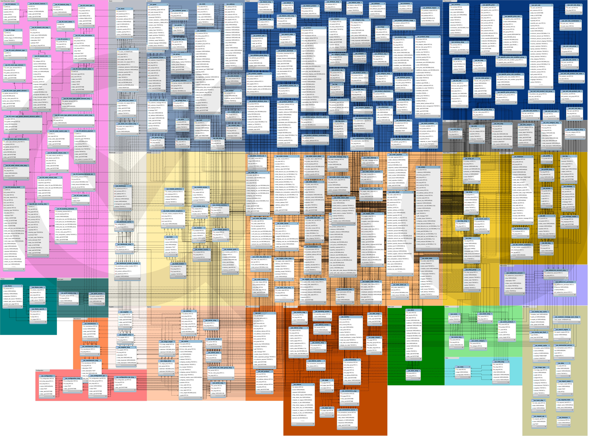

# Database Schema

This database schema is a diagram that shows the storage of data in the QloApps database. It describes both the organization of data and the relationships between tables in the QloApps database.

::: warning
The diagram above is the schema of an earlier release and does not show the tables listed below. The authoritative schema of QloApps 1.8.0 is `install-dev/data/db_structure.sql` (core tables) and `modules/hotelreservationsystem/classes/HotelReservationSystemDb.php` (the `htl_*` tables of the Hotel Reservation System module).
:::

## Main changes in 1.8.0

Core tables (`install-dev/data/db_structure.sql`; the `install` folder was renamed to `install-dev`):

- Added: `tax_configuration`, `tax_price_tier`, `tax_child_range`, `tax_validity_range` (tourism tax settings), `order_tax_detail` and `order_tax_exemption`. The `tax` table has a new `is_tourism_tax` column.
- Removed: `order_detail_tax` (replaced by `order_tax_detail`).
- Added: `business_source`, `business_source_lang`, `source` and `source_lang` (booking sources).
- Added: `cart_rule_hotel` (restricts a cart rule to selected hotels).
- Added: `room_type_selling_object` and `room_type_selling_object_lang`.

Hotel Reservation System module tables (`htl_*`):

- Added: `htl_amenity`, `htl_amenity_lang`, `htl_branch_amenity` and `htl_room_type_amenity` (amenities replace the former features tables).
- Added: `htl_booking_status`, `htl_booking_status_lang` and `htl_booking_status_history`.
- Added: `htl_connected_room`, `htl_image_category`, `htl_image_category_lang`, `htl_header_image`, `htl_header_image_lang`, `htl_property_type` and `htl_property_type_lang`.
- Removed (no longer created, and only dropped on uninstall for bed types): `htl_features`, `htl_features_lang`, `htl_branch_features`, `htl_bed_type`, `htl_bed_type_lang`, `htl_room_type_bed_type`, and the extra demands tables `htl_booking_demands`, `htl_booking_demands_tax`, `htl_room_type_demand`, `htl_room_type_demand_price`, `htl_room_type_global_demand`, `htl_room_type_global_demand_lang`, `htl_room_type_global_demand_advance_option` and `htl_room_type_global_demand_advance_option_lang`.

